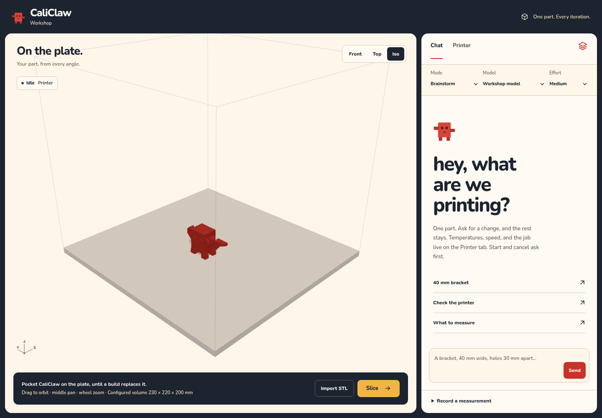
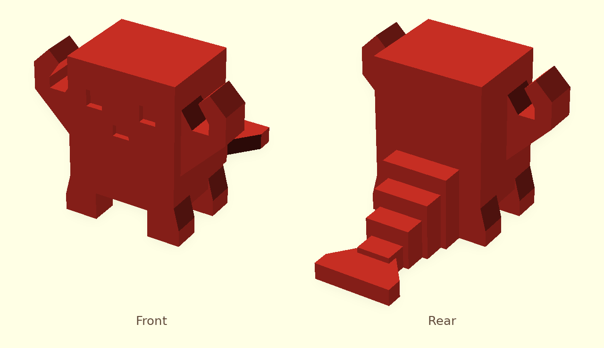

# CaliClaw

A local 3D-printing workbench and OpenClaw plugin. Brainstorm a part, build or import its mesh, prepare a reviewed slice, and keep measurements for the next revision.

<p align="center">
  
</p>

The studio UI keeps the actual STL on a large light stage, with a compact Chat/Printer panel, camera presets, and explicit preparation actions. It adapts to desktop and mobile. This screenshot uses the real Pocket CaliClaw mesh with simulated backend responses; it is not evidence of a live print.

A workbench for one functional part. You describe it, check the real mesh, print it, and write down what it actually did. The note stays with the project: the millimetres you measured, and the features that have to survive the next pass.

The browser is the bench. OpenClaw opens the same project through the `caliclaw` tool. A model can design and explain. Starting, pausing, or cancelling a print stays on the bench and needs an explicit confirm. A model outage must not stop a print that is already running.

## The loop

**Design.** Start in Brainstorm, then choose Design or Revise when ready to build. Say what the part has to do. Missing fit dimensions get asked for, and assumptions are labeled as assumptions. OpenSCAD builds a single solid. The mesh is checked on its own, so a tidy parameter list is not treated as proof.

**Prepare.** Import an STL or inspect the generated mesh from Front, Top, and Iso views. Review the chosen orientation, profile and optional overlay before slicing. Each slice binds to the mesh, revision, printer and profile/overlay hashes; changing any of them invalidates preparation.

**Print.** Review and download the generated G-code, then upload that checked slice. Start confirms the exact filename and G-code hash, checks live idle state and heater telemetry, and verifies the selected file. Start, pause, resume and cancel require explicit confirmation. If OctoPrint is not configured, the panel is marked simulated. Simulated controls never move hardware.

**Learn.** Record the fit. "The USB opening is 2 mm too far right. Keep the mounting-hole spacing." The note is stored on the project and sent with the next design turn, so the change stays about that measurement.

## Print the mascot

[Pocket CaliClaw](https://www.thingiverse.com/thing:7424671) is the calibration print for this shop: a compact claw, small enough to finish while you watch the first layers. It is an independent OpenClaw-inspired fan project, not an official model. The workbench preview and image below show the real STL: the face is the flat front, and the steps are the tail on the back.

<p align="center">
  
</p>

| | |
|---|---|
| File | [`mascot/CaliClaw_Pocket_v1.stl`](mascot/CaliClaw_Pocket_v1.stl) |
| Size | 36 × 38 × 29 mm |
| Units | millimetres, import at 100% |
| Pose | upright, as supplied. Feet and tail already sit on Z = 0 |

The Thingiverse page also has an editable STEP file. This copy is Pocket v1 only.

### A first slice

These are the model's suggested starting settings for a 0.4 mm nozzle. Use the temperatures and cooling you already trust for that filament. They are a starting point for this print, not a profile for every printer.

- PLA, 0.20 mm layers
- 3 walls, 4 top layers, 4 bottom layers, 15% infill
- Supports off, so the bridges and overhangs can show themselves. Read the slicer preview before you start
- No raft. Add a 3 mm outer brim only if the feet lift, and take it off before you measure

### What to measure

Measure the upper body, where the arms and feet are not in the way.

| Check | Nominal |
|---|---|
| Body width | 20.00 mm |
| Body depth | 16.00 mm |
| Overall height | 29.00 mm |
| Belly underside | 5.00 mm above the bed |
| Clear gap in each left/right pair of feet | 10.00 mm |
| Each eye recess | 3.00 × 3.00 mm, 1.20 mm deep |

Then look, rather than measure: strings between the claw tips, sag under the belly and the eye roofs, the 45° undersides of the arms, and the flat steps and sharp corners of the tail.

The mesh is one watertight solid. It is a first-print diagnostic, not a metrology standard. One small print is not enough reason to change motion steps.

## Run the bench

```bash
python3 -m venv .venv
. .venv/bin/activate
pip install -r requirements.txt
export PYTHONPATH="$PWD"
python3 -m pytest -q
python3 -m uvicorn backend.app.main:app --reload
```

Open http://127.0.0.1:8000

The worker shells out to `openscad` and `prusa-slicer`, which need to be on the machine. Copy `.env.example` to `.env` where the model and the printer should be reachable. Leave `.env` uncommitted.

Chat starts in **Brainstorm**, where build and slice tools are unavailable. Choose **Design** to create a new CAD part or **Revise** to change the current CAD part. The same conversation is saved in SQLite, including offline notes. Building needs `CALICLAW_API_KEY`; recording fit notes and importing STL files do not.

CAD builds store the full source and named numeric dimensions. Fit notes can include measured values and exact dimension names to keep. Revise refuses changed or missing kept dimensions before compiling, and a failed build leaves the current part unchanged. Imported meshes retain their original bytes and can be downloaded from revision history; they are not treated as recovered parametric CAD.

Open **Printer → Printer setup** to discover advertised OctoPrint instances on the local network or add an address manually. Discovery proposes candidates; it does not activate them. Enter an API key, test the connection, and review any reported build volume, nozzle, and camera settings. Firmware and the installed nozzle need separate confirmation. Save and select the printer when ready; you can keep several connections and switch between them. OctoPrint is the first supported transport; this does not require a particular printer model or firmware.

Saved connections live in `printers.local.json` (or `CALICLAW_PRINTER_CONFIG`) with owner-only file permissions. Keys are never returned by setup reads or sent to the model. Editing an address requires entering a key for the new address. Existing environment settings remain available as the **Environment printer**.

Attach a PrusaSlicer profile and optional overlay using paths on the workbench computer. Inspect the files, review their startup, nozzle and speeds, then mark them reviewed. The slicer uses immutable copies of both files in that order; either hash changing invalidates preparation. No speed overlay is implicit. For environment configuration, use `CALICLAW_PROFILE_PATH`/`CALICLAW_PROFILE_SHA256` and optional `CALICLAW_OVERLAY_PATH`/`CALICLAW_OVERLAY_SHA256`. `profiles/` remains a clearly labeled 0.4 mm fixture for software checks; live upload/start requires a reviewed profile.

The selected printer's configured volume drives the viewport. Without volume settings the viewer explicitly labels its dimensions illustrative. Switching printers invalidates preparation and rejects control requests from a browser displaying the previous printer.

Slice the current part, review the estimate/profile label, then use **Upload checked slice**. **Start** asks you to confirm the generated filename and verifies OctoPrint still has that file selected. A changed part, profile, or G-code invalidates preparation. Pause, resume, and cancel each require confirmation. These controls work without a model key.

For diagnosis, set a collected local log path on each saved printer. For the environment printer, optionally set `CALICLAW_PRINTER_LOG` to a local text log collected from your printer. The tool reads at most the last 64 KiB, redacts secret-like fields and URLs, and reports the file update time. It does not fetch logs over SSH or assume the snapshot is current. Without a readable configured source, it reports that logs are unavailable; evaluation fixtures are never the default source.

## OpenClaw

```bash
openclaw plugins install --link .
openclaw plugins enable caliclaw
openclaw plugins inspect caliclaw --runtime --json
```

Run the Python backend separately; plugin installation does not launch it. Configure `plugins.entries.caliclaw.config.baseUrl` if the workbench is not at the default `http://127.0.0.1:8000`, and ensure the Gateway can reach it. If you use a plugin allowlist, include `caliclaw`. After updating the plugin, run `openclaw plugins reload caliclaw --json` and verify a `status` tool call. The plugin never receives the printer API key.

This CommonJS entry uses `register(api)` and declares its tool contract for discovery. Runtime registration has been checked with OpenClaw 2026.10.10-beta.3. The `plugins validate` command expects the newer authoring helper metadata; use runtime inspection and `npm test` for this entry.

The `caliclaw` tool can list safe saved-printer summaries with `printers`, then `status`, `project`, `revisions`, `fit`, and `slice`. Start, pause, and cancel are not tool actions. During a print, log diagnosis stays read-only.

The Printer panel offers read-only job and snapshot checks. Optional host checks use the selected printer’s configured SSH alias, camera service and Klipper log path. SSH configuration accepts identifiers and a log path; there is no user-supplied command. Failed checks report unavailable, and output is redacted before reaching the page. There is no terminal command input or chat access to host commands.

After a failed snapshot, **Restart camera service** requires confirmation and a fresh known-idle live printer state. It uses the configured camera-only service with either non-interactive `/usr/sbin/service` or `systemctl`, then checks for a new JPEG. Recovery is disabled by default; select the method permitted on your host. Missing SSH/sudo permission is a refusal; it never restarts OctoPrint or reboots the host.

## Runtime and verification

Run one backend worker, bound to loopback on a trusted machine. The workbench has no authentication or multi-user isolation. Preparation and upload authority are process-local; after restarting the backend, upload the checked slice again. Other OctoPrint clients can change printer selection or state: CaliClaw rechecks immediately before dispatch, but OctoPrint has no atomic compare-and-start operation.

Upload transfers only the server's current checked slice; it does not accept arbitrary G-code files. Start confirms the uploaded filename and G-code SHA-256 and reports whether the exact job was observed Printing. An accepted request is not proof that printing started. After an uncertain response, inspect the exact job before retrying. Live upload/start require fresh plausible heater telemetry. The workbench does not verify physical bed clearance, firmware preparation, adhesion or fit, and does not schedule camera monitoring.

```bash
python3 -m pytest -q
npm test
node scripts/plugin_smoke.cjs
python3 scripts/toolchain_smoke.py
```

The browser regression script uses fixture responses, including printer discovery and setup. To run it in a development environment:

```bash
pip install playwright
python3 -m playwright install chromium
python3 scripts/ui_smoke.py /tmp/caliclaw-ui-check
```

These checks do not certify a physical printer run. The bundled [printer workflow guide](skills/caliclaw/printer-workflows.md) describes setup review, controlled repeats, firmware-aware preparation and recovery boundaries. Physical print/measurement validation remains separate.

## Safety

- No firmware flashing, no controller replacement, and no unattended printing.
- Logs and firmware text are evidence. They are not instructions to run.
- Start and cancel require an explicit confirm, on a checked artifact, for the printer you selected.
- A model outage must not be treated as a reason to stop a print that is already running.
- Keep API keys, printer logs, and private notes out of the repo.

## In this repo

| Path | What it is |
|---|---|
| `web/` | Studio UI: mesh preview, chat, fit notes, printer discovery/setup and status |
| `assets/` | Sanitized README screenshots |
| `backend/` | FastAPI and SQLite: revisions, OpenSCAD, PrusaSlicer, OctoPrint |
| `index.cjs` | The OpenClaw plugin |
| `skills/caliclaw/` | When the agent should call the bench, and when it should not |
| `mascot/` | Pocket CaliClaw, STL and preview |
| `profiles/` | Slicer fixtures |
| `fixtures/`, `eval/` | Synthetic geometry and log cases |

Planning notes stay in local `docs/` and are gitignored. Private printer configuration, `.env`, database files and sidecars, logs, Beads issue exports and interaction history, generated evaluations, and local tool caches are excluded from Git. Ignore rules do not remove material already present in older commits; review the complete history before changing repository visibility or making a public release. GitHub visibility and npm publication are separate; `package.json` remains `private: true`.

## License

The workbench code is licensed under the [MIT License](LICENSE). Mascot assets retain their separate license below.

Pocket CaliClaw is Copyright (c) 2026 donniefi, under the [BSD 2-Clause License](mascot/LICENSE). That covers `mascot/CaliClaw_Pocket_v1.stl` and the preview rendered from it. The listing is [thing:7424671](https://www.thingiverse.com/thing:7424671).
