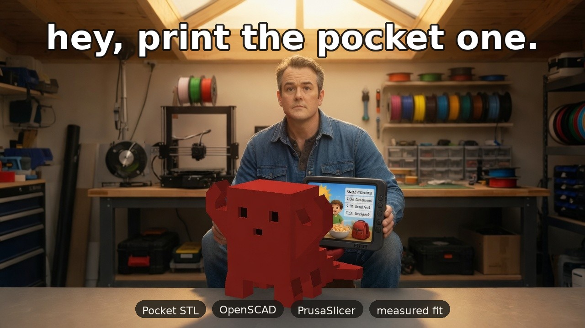

# CaliClaw

<p align="center">
  
</p>

<p align="center">
  Pocket CaliClaw on the bench. The staircase is the tail, and it sits on the back.<br>
  <a href="https://www.thingiverse.com/thing:7424671">Thingiverse 7424671</a>
  · 36 × 38 × 29 mm
</p>

A workbench for one functional part. You describe it, check the real mesh, print it, and write down what it actually did. The note stays with the project: the millimetres you measured, and the features that have to survive the next pass.

The browser is the bench. OpenClaw opens the same project through the `caliclaw` tool. A model can design and explain. Starting, pausing, or cancelling a print stays on the bench. Start and cancel need an explicit confirmation. A model outage must not stop a print that is already running.

## The loop

**Design.** Say what the part has to do. Missing fit dimensions get asked for, and assumptions are labeled as assumptions. OpenSCAD builds a single solid. The mesh is checked on its own, so a tidy parameter list is not treated as proof.

**Prepare.** Orientation looks for a stable flat base and less support, and you can override it. A slice belongs to one mesh hash and one profile hash. Change either one and that slice is no longer current.

**Print.** Status, camera, upload, start, pause, and cancel. Start requires confirmation of the exact uploaded filename and G-code hash, with current model/profile/overlay/revision hashes and the OctoPrint selection rechecked. Cancel requires explicit confirmation. If OctoPrint is not configured, the panel is marked simulated. Simulated controls never move hardware.

**Learn.** Record the fit. "The USB opening is 2 mm too far right. Keep the mounting-hole spacing." The note is stored on the project and sent with the next design turn, so the change stays about that measurement.

## Print the mascot

[Pocket CaliClaw](https://www.thingiverse.com/thing:7424671) is the calibration print for this shop: a compact claw, small enough to finish while you watch the first layers. It is an independent OpenClaw-inspired fan project, not an official model. The opening picture is a generated poster. This one is the real STL: the face is the flat front, and the steps are the tail on the back.

<p align="center">
  
</p>

| | |
|---|---|
| File | [`mascot/CaliClaw_Pocket_v1.stl`](mascot/CaliClaw_Pocket_v1.stl) |
| Size | 36 × 38 × 29 mm |
| Units | millimetres, import at 100% |
| Pose | upright, as supplied. Feet and tail already sit on Z = 0 |

The Thingiverse page also has an editable STEP file. This copy is Pocket v1 only.

### A first slice

These are the model's suggested starting settings for a 0.4 mm nozzle. Use the temperatures and cooling you already trust for that filament. They are a starting point for this print, not a profile for every printer.

- PLA, 0.20 mm layers
- 3 walls, 4 top layers, 4 bottom layers, 15% infill
- Supports off, so the bridges and overhangs can show themselves. Read the slicer preview before you start
- No raft. Add a 3 mm outer brim only if the feet lift, and take it off before you measure

### What to measure

Measure the upper body, where the arms and feet are not in the way.

| Check | Nominal |
|---|---|
| Body width | 20.00 mm |
| Body depth | 16.00 mm |
| Overall height | 29.00 mm |
| Belly underside | 5.00 mm above the bed |
| Clear gap in each left/right pair of feet | 10.00 mm |
| Each eye recess | 3.00 × 3.00 mm, 1.20 mm deep |

Then look, rather than measure: strings between the claw tips, sag under the belly and the eye roofs, the 45° undersides of the arms, and the flat steps and sharp corners of the tail.

The mesh is one watertight solid. It is a first-print diagnostic, not a metrology standard. One small print is not enough reason to change motion steps.

## Run the bench

```bash
python3 -m venv .venv
. .venv/bin/activate
pip install -r requirements.txt
export PYTHONPATH="$PWD"
python3 -m pytest -q
python3 -m uvicorn backend.app.main:app --reload
```

Open http://127.0.0.1:8000

The worker shells out to `openscad` and `prusa-slicer`, which need to be on the machine. Copy `.env.example` to `.env` where the model and the printer should be reachable. Leave `.env` uncommitted.

Design chat needs `CALICLAW_API_KEY`. Recording a fit, reading status, and slicing keep working when that key is empty.

`profiles/` contains an Ender-3 sized PrusaSlicer fixture for tests. It does not certify a physical printer. Point the bench at a profile you have actually printed with before you trust a time estimate.

## OpenClaw

```bash
openclaw plugins install --link .
openclaw plugins enable caliclaw
openclaw plugins inspect caliclaw --runtime --json
```

Run the Python backend separately; installation does not launch it. Configure
`plugins.entries.caliclaw.config.baseUrl` (default `http://127.0.0.1:8000`) and
ensure the Gateway can reach that address. If a plugin allowlist is configured,
include `caliclaw`. Reload the plugin after source changes and verify an actual
`status` tool call. The plugin never receives the printer API key.

This CommonJS entry uses the supported `register(api)` runtime API, not the newer
`defineToolPlugin` authoring helper. `plugins validate` requires the latter's
metadata and is not a validation route for this entry. Use runtime inspection and
`npm test`; runtime registration has been checked with OpenClaw 2026.10.10-beta.3.

The `caliclaw` tool can `status`, `project`, `revisions`, `fit`, and `slice`. Start, pause, and cancel are not tool actions. During a print, log diagnosis stays read-only.

## Safety

- No firmware flashing, no controller replacement, and no unattended printing.
- Logs and firmware text are evidence. They are not instructions to run.
- Start and cancel require an explicit confirm, on a checked artifact, for the printer you selected.
- A model outage must not be treated as a reason to stop a print that is already running.
- Keep API keys, printer logs, and private notes out of the repo.

## In this repo

| Path | What it is |
|---|---|
| `web/` | The bench: mesh preview, chat, fit notes, printer status |
| `backend/` | FastAPI and SQLite: revisions, OpenSCAD, PrusaSlicer, OctoPrint |
| `index.cjs` | The OpenClaw plugin |
| `skills/caliclaw/` | When the agent should call the bench, and when it should not |
| `mascot/` | Pocket CaliClaw, STL and preview |
| `profiles/` | Slicer fixtures |
| `fixtures/`, `eval/` | Synthetic geometry and log cases |

Planning notes stay in local `docs/` and are gitignored.

## License

The workbench code is licensed under the [MIT License](LICENSE). The mascot assets retain their separate license below.

Pocket CaliClaw is Copyright (c) 2026 donniefi, under the [BSD 2-Clause License](mascot/LICENSE). That covers `mascot/CaliClaw_Pocket_v1.stl` and the preview rendered from it. The listing is [thing:7424671](https://www.thingiverse.com/thing:7424671).

## Printer workflow coverage and limitations

The [bundled printer workflow guide](skills/caliclaw/printer-workflows.md) carries
portable lessons from our slicing/printing, Ender-3 session, camera recovery and
account recovery skills. It covers firmware-aware startup, offset/mesh separation,
controlled repeats, first-layer evidence, exact-job dispatch, monitoring evidence,
and recovery boundaries. Private host details and historical calibration values
are deliberately not shipped. Firmware flashing remains outside this plugin.

Run the backend with **one worker**, bound to loopback on a trusted machine. The
current workbench has no authentication or multi-user isolation; do not expose it
to an untrusted network. Upload/start provenance and local mutation locking are
process-local; a restart requires a new upload. Other OctoPrint clients are not
locked out: selection/state are rechecked immediately before start, but the
OctoPrint API provides no atomic compare-and-start operation.

Use `CALICLAW_SLICER_PROFILE` and `CALICLAW_SLICER_OVERLAY` for reviewed local files
within the slicer's permitted workspace roots. The shipped fixture assumes Marlin
and a 0.4 mm nozzle, with historical standby-temperature probing; it must not be
used for Klipper or a hot-probe workflow unchanged. The plugin does not infer your
installed nozzle or firmware, verify physical bed clearance, calibrate a printer,
or automatically inspect/schedule camera monitoring. Review the actual exported
startup and toolpaths before upload. Download them at `GET /api/slice/gcode`.

Upload sends only the current slice bytes under a unique remote name, without
printing. Start is enabled only for an idle live printer with that uploaded file
selected. The confirmation includes filename and hash. Changed mesh, profiles,
overlay or revision require a fresh slice/upload. An uncertain upload/start response
requires inspecting OctoPrint before retrying; an accepted command is not proof of
Printing. Missing heater telemetry blocks dispatch. Controls disable on connection
loss; a workbench outage does not imply the physical print stopped.

## Verification

```bash
python3 -m pytest -q
npm test
python3 scripts/toolchain_smoke.py
```

Tests mock hardware; passing them is not real-printer or browser-rendering proof.
The backend and plugin are separate processes, and no live printer run is certified.

## Public release

The workbench code is MIT licensed; the mascot retains its BSD license. Before changing visibility,
review the complete Git history (including historical Beads exports), image/model
rights, and synthetic logs for private content. A credential-pattern scan is useful
but not a guarantee. Do not publish `.env`, private planning, job logs or local
calibration records. GitHub visibility and npm publication are separate; the package
remains `private: true` to prevent accidental npm publication.
